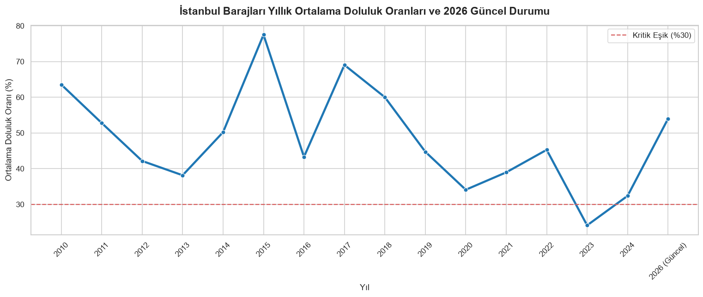
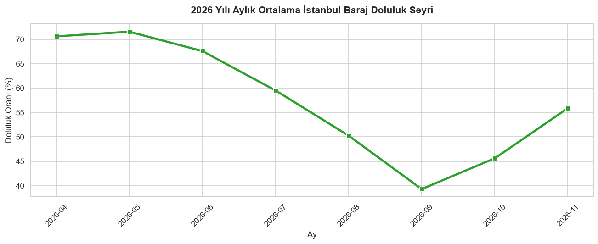
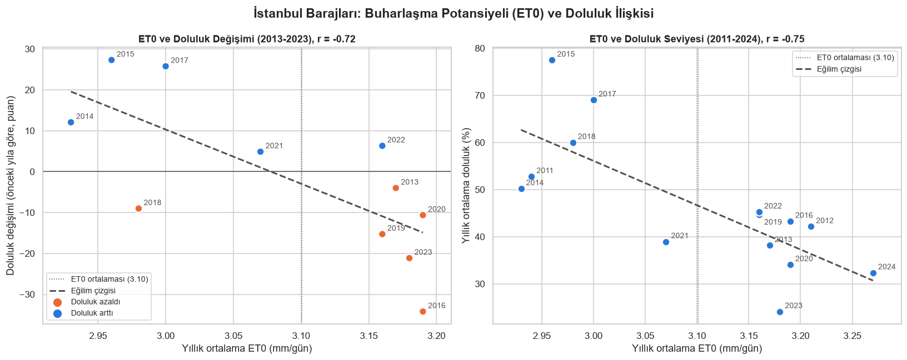
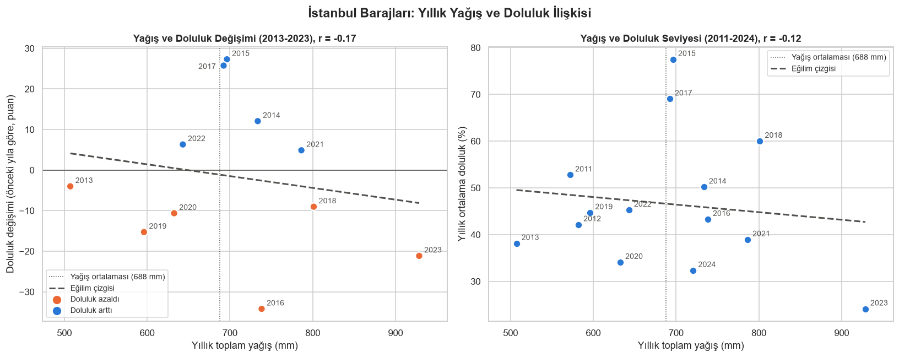

# İstanbul Baraj Doluluk Oranları ve İklim Faktörleri Veri Analizi Raporu

**SoftITO Veri Analizi Eğitimi - Proje Raporu** · Kasım 2026
**Analiz dosyası:** [`istanbul_su_analizi_final.ipynb`](istanbul_su_analizi_final.ipynb) · **Araçlar:** Python, pandas, NumPy, Matplotlib, Seaborn

---

## Yönetici Özeti
- İstanbul barajlarının yıllık ortalama doluluğu 2010-2024 arasında büyük dalgalanmalar göstermiştir. En yüksek yıl **2015 (%77.49)**, en düşük yıl **2023 (%24.12)**'tür. Baraj sayısının sabit olduğu yıllarda ortalama doluluk **2012-2019'da %53.1** iken **2020-2023'te %35.6**'ya düşmüştür.
- Barajlar yıl içinde her yaz çekilmektedir: 2026'da doluluk mayıstaki **%71.55**'ten eylülde **%39.30**'a inmiş, ekimde toparlanmaya başlamıştır.
- **Buharlaşma potansiyeli (ET0) ile baraj doluluğu arasında güçlü ve ters yönlü bir ilişki** bulunmuştur (r = -0.75). ET0'ın ortalamanın üzerinde olduğu yıllarda ortalama doluluk %38.01, altında olduğu yıllarda %58.07'dir.
- **Yıllık toplam yağış ile doluluk arasında anlamlı bir ilişki görülmemiştir** (r = -0.12). Bunun başlıca nedeni, yağışın yıl içinde ne zaman düştüğünün yıllık toplamda kaybolmasıdır.
- 9 Kasım 2026 itibarıyla kapasiteye göre ağırlıklı toplam doluluk **%61.9**'dur. Su güvenliği açısından asıl izlenmesi gereken grup, toplam kapasitenin %47.77'sini tutan **Terkos, Büyükçekmece ve Sazlıdere** barajlarıdır.

---

## 1. Giriş ve Amaç
İstanbul'un su arzı büyük ölçüde yüzey suyu barajlarına dayanır ve bu barajların doluluğu iklim koşullarına duyarlıdır. Bu çalışmanın amacı:
1. İstanbul barajlarının doluluk oranlarının **yıllara** ve **aylara** göre nasıl değiştiğini ortaya koymak,
2. **Sıcaklık, yağış ve buharlaşma potansiyeli** gibi iklim faktörlerinin mevsimsel ve yıllık seyrini incelemek,
3. Bu iklim faktörleri ile baraj doluluğu arasındaki **ilişkiyi** ölçmek,
4. Barajların güncel durumuna göre **risk gruplandırması** yapmak ve su yönetimi için öneriler sunmaktır.

## 2. Veri Setleri ve Yöntem
Analizde, notebook'ta doğrudan kodla işlenen 4 veri seti kullanılmıştır. Tüm veriler CSV olarak indirilmiş ve kaynaktan geldiği haliyle okunmuştur; kaynakta bulunmayan hiçbir değişken eklenmemiştir.

| Dosya Adı | Veri Türü | Kapsam ve Kullanım Amacı |
|---|---|---|
| baraj-yillik-doluluk.csv | CSV (Yapılandırılmış Yıllık Zaman Serisi) | Türkiye geneli ve İstanbul barajlarının 2010-2024 yılları arasındaki yıllık doluluk oranlarını sağlar. Tarihsel trend analizinin temelidir. |
| baraj-doluluk-istanbul-1100g.csv | CSV (Günlük Zaman Serisi) | İstanbul barajlarına ait 2026 yılı güncel günlük doluluk oranlarını içerir. Mevsimsel güncelliği ve yıl içi değişimi yansıtır. |
| barajlar.csv | CSV (Baraj Detay ve Anlık Doluluk Tablosu) | Tüm barajların anlık doluluk yüzdelerini (fill_rate) ve kapasite bilgilerini alarak risk gruplandırma tablosunu oluşturmak için kullanıldı. |
| open-meteo-41.02N28.89E32m.csv | CSV (Günlük Meteoroloji Zaman Serisi) | İstanbul için 27.10.2010 sonrası günlük sıcaklık, yağış, rüzgâr ve buharlaşma potansiyeli (ET0) verilerini içerir (Open-Meteo Historical Weather API). Aylık ve yıllık iklim analizleri ile baraj-iklim karşılaştırmasında kullanıldı. |

**Meteoroloji verisi hakkında:** Open-Meteo Historical Weather API'de İstanbul için 41.0138° K, 28.9497° D koordinatları sorgulanmış; API en yakın model ızgara noktasının (41.02° K, 28.89° D, rakım 32 m) verisini döndürmüştür. Bu veri tek bir istasyonun ölçümü değil, reanaliz tabanlı ızgara verisidir. Meteoroloji Genel Müdürlüğü'nün il istatistikleri yalnızca uzun dönem aylık ortalamalarını verdiği için yıl bazında karşılaştırmaya uygun bulunmamıştır.

**Buharlaşma potansiyeli (ET0):** Kaynaktaki `et0_fao_evapotranspiration` değişkenidir; FAO-56 Penman-Monteith yöntemiyle sıcaklık, güneş ışınımı, rüzgâr ve nemden hesaplanan **referans evapotranspirasyondur**. Atmosferin buharlaştırma talebinin göstergesidir; baraj yüzeyinden ölçülmüş gerçek buharlaşma değildir.

**Yöntem özeti:**
- Günlük veriler `groupby` ile aylık ve yıllık özetlere dönüştürülmüştür (sıcaklık ve ET0 için ortalama, yıllık yağış için toplam).
- Baraj ve iklim tabloları yıl üzerinden **left join** (`merge(how='left')`) ile birleştirilmiş, bir önceki yıla göre değişimler `diff()` ile hesaplanmıştır.
- İlişkilerin gücü **Pearson korelasyon katsayısı (r)** ile ölçülmüş ve saçılım grafikleriyle görselleştirilmiştir.
- Barajlar güncel doluluk oranlarına göre `pd.cut()` ile risk gruplarına ayrılmıştır.

## 3. Barajların Yıllık Doluluk Seyri (2010-2024)
`baraj-yillik-doluluk.csv` dosyasından İstanbul barajlarının yıllık ortalamaları hesaplanmış, 2026 günlük verisinin ortalaması "2026 (Güncel)" olarak eklenmiştir. 2025 yılına ait veri, kullanılan veri setlerinde bulunmamaktadır.

| Yıl | İstanbul Ortalama Doluluk Oranı (%) |
|---|---:|
| 2010 | 63.54 |
| 2011 | 52.77 |
| 2012 | 42.15 |
| 2013 | 38.14 |
| 2014 | 50.20 |
| 2015 | 77.49 |
| 2016 | 43.28 |
| 2017 | 69.03 |
| 2018 | 60.00 |
| 2019 | 44.72 |
| 2020 | 34.08 |
| 2021 | 38.95 |
| 2022 | 45.26 |
| 2023 | 24.12 |
| 2024 | 32.36 |
| 2026 (Güncel) | 53.96 |

**Değerlendirme:**
- Yıllık doluluk istikrarlı değildir. En yüksek yıllar **2015 (%77.49)** ve **2017 (%69.03)**, en düşük yıllar **2023 (%24.12)**, **2024 (%32.36)** ve **2020 (%34.08)**'dir. %30 kritik eşiğin altına inen tek yıl 2023'tür.
- Doluluk 2013, 2016, 2020 ve 2023'te dip yapmıştır; ancak 14 yıllık seri bunun düzenli bir döngü olduğunu söylemek için yeterli değildir.
- **Veri notu:** Yıllık değerler, verisi bulunan barajların basit (kapasiteye göre ağırlıklandırılmamış) ortalamasıdır. Verisi bulunan baraj sayısı 2010-2011'de 6, 2012-2023'te 13, 2024'te 14'tür.
- **2026 değeri (%53.96)** yalnızca 16 Nisan - 7 Kasım arasındaki 141 günü kapsar ve kış aylarını içermez; grafikte aynı çizgide gösterilse de yıllık ortalamalarla doğrudan karşılaştırılmamalıdır.

## 4. Yıl İçi Doluluk Seyri: 2026
2026 günlük doluluk verisi aylık olarak gruplanmıştır.

| Ay | Ölçüm Gün Sayısı | Ortalama Doluluk (%) | Minimum Doluluk (%) | Maksimum Doluluk (%) |
|---|---:|---:|---:|---:|
| 2026-04 | 9 | 70.60 | 70.30 | 71.10 |
| 2026-05 | 4 | 71.55 | 71.10 | 72.00 |
| 2026-06 | 25 | 67.57 | 64.30 | 70.50 |
| 2026-07 | 24 | 59.51 | 54.70 | 63.70 |
| 2026-08 | 22 | 50.25 | 44.30 | 54.40 |
| 2026-09 | 28 | 39.30 | 36.20 | 43.40 |
| 2026-10 | 25 | 45.61 | 37.70 | 53.80 |
| 2026-11 | 4 | 55.88 | 53.70 | 61.90 |

**Değerlendirme:**
- **Bahar zirvesi:** En yüksek seviyeler nisan (%70.60) ve mayıs (%71.55) aylarındadır. Bu iki ayın ortalamaları yalnızca 9 ve 4 günlük ölçüme dayanmaktadır.
- **Yaz çekilmesi:** Doluluk haziran ayından itibaren her ay düzenli olarak azalmış ve eylülde **%39.30**'a inmiştir (en düşük günlük değer %36.2). Mayıstan eylüle yaklaşık 32 puanlık bir kayıp vardır.
- **Sonbahar toparlanması:** Ekimde doluluk yeniden yükselmeye başlamış (%45.61), kasımın ilk günlerinde %55.88'e ulaşmıştır.
- Çekilmenin yaşandığı haziran-eylül dönemi, Bölüm 5'te görülen en sıcak, buharlaşma potansiyeli en yüksek ve en kurak aylara denk gelmektedir. Yaz aylarında artan su tüketimi de çekilmeye katkı yapmış olabilir; ancak veri setinde tüketim bilgisi bulunmadığından bu etki ölçülememiştir.

## 5. İklim Faktörleri: Aylık Analiz (2020-2025)
Open-Meteo günlük verisi 2020-2025 dönemi için yıl ve ay bazında gruplanmıştır. Analize 2192 gün girmiş, kullanılan sütunlarda eksik değer bulunmamıştır.

| Sütun | Anlamı |
|---|---|
| `ort_en_yuksek_sicaklik_C` | Ay içindeki günlük en yüksek sıcaklıkların ortalaması (°C) |
| `ort_gunluk_yagis_mm` | Günde düşen ortalama yağış (mm/gün); aylık toplam ≈ değer × ayın gün sayısı |
| `ort_ruzgar_hizi_kmh` | 10 m yükseklikteki günlük ortalama rüzgâr hızının aylık ortalaması (km/sa) |
| `ort_gunluk_et0_mm` | Günlük referans evapotranspirasyonun aylık ortalaması (mm/gün) |

<b>İstanbul aylık iklim özeti tablosunun tamamı (72 satır) - açmak için tıklayın</b>

| yil | ay | ort_en_yuksek_sicaklik_C | ort_gunluk_yagis_mm | ort_ruzgar_hizi_kmh | ort_gunluk_et0_mm |
|---:|---:|---:|---:|---:|---:|
| 2020 | 1 | 8.77 | 4.08 | 17.37 | 1.10 |
| 2020 | 2 | 10.90 | 2.37 | 17.82 | 1.73 |
| 2020 | 3 | 12.99 | 2.29 | 15.84 | 2.05 |
| 2020 | 4 | 14.80 | 1.99 | 18.55 | 3.07 |
| 2020 | 5 | 20.69 | 2.16 | 13.00 | 4.00 |
| 2020 | 6 | 25.34 | 2.38 | 11.08 | 4.76 |
| 2020 | 7 | 28.89 | 0.07 | 18.71 | 5.92 |
| 2020 | 8 | 29.55 | 0.14 | 17.41 | 5.73 |
| 2020 | 9 | 27.21 | 0.59 | 16.90 | 4.42 |
| 2020 | 10 | 22.76 | 2.88 | 10.83 | 2.52 |
| 2020 | 11 | 15.09 | 0.69 | 16.49 | 1.64 |
| 2020 | 12 | 13.37 | 1.11 | 16.04 | 1.29 |
| 2021 | 1 | 11.15 | 4.80 | 17.76 | 1.36 |
| 2021 | 2 | 10.57 | 2.06 | 16.38 | 1.67 |
| 2021 | 3 | 10.20 | 2.75 | 15.43 | 1.82 |
| 2021 | 4 | 14.67 | 2.34 | 14.34 | 2.67 |
| 2021 | 5 | 22.02 | 1.94 | 13.65 | 4.24 |
| 2021 | 6 | 24.18 | 2.88 | 10.39 | 4.34 |
| 2021 | 7 | 29.27 | 1.27 | 15.89 | 5.61 |
| 2021 | 8 | 30.52 | 0.23 | 15.17 | 5.59 |
| 2021 | 9 | 24.21 | 0.86 | 16.31 | 4.14 |
| 2021 | 10 | 18.55 | 1.36 | 17.03 | 2.28 |
| 2021 | 11 | 15.93 | 2.65 | 14.98 | 1.64 |
| 2021 | 12 | 11.78 | 2.71 | 18.24 | 1.32 |
| 2022 | 1 | 8.15 | 2.56 | 17.64 | 1.19 |
| 2022 | 2 | 9.65 | 5.50 | 15.35 | 1.35 |
| 2022 | 3 | 8.14 | 1.35 | 16.11 | 1.84 |
| 2022 | 4 | 16.58 | 2.64 | 14.59 | 3.06 |
| 2022 | 5 | 21.87 | 0.75 | 13.36 | 4.50 |
| 2022 | 6 | 25.74 | 1.50 | 14.84 | 4.86 |
| 2022 | 7 | 28.69 | 0.53 | 18.33 | 6.10 |
| 2022 | 8 | 29.15 | 1.60 | 15.25 | 4.85 |
| 2022 | 9 | 24.83 | 1.67 | 13.95 | 3.96 |
| 2022 | 10 | 20.17 | 0.70 | 16.31 | 2.69 |
| 2022 | 11 | 17.44 | 0.85 | 16.02 | 2.13 |
| 2022 | 12 | 13.40 | 1.85 | 15.07 | 1.30 |
| 2023 | 1 | 11.79 | 0.75 | 14.64 | 1.36 |
| 2023 | 2 | 9.72 | 1.75 | 18.36 | 1.65 |
| 2023 | 3 | 12.60 | 4.21 | 15.98 | 1.76 |
| 2023 | 4 | 15.83 | 3.50 | 13.53 | 2.63 |
| 2023 | 5 | 19.32 | 2.31 | 15.32 | 3.36 |
| 2023 | 6 | 25.03 | 1.03 | 14.32 | 4.68 |
| 2023 | 7 | 30.90 | 0.72 | 13.96 | 6.25 |
| 2023 | 8 | 30.96 | 0.12 | 19.85 | 5.80 |
| 2023 | 9 | 27.41 | 2.32 | 18.63 | 4.67 |
| 2023 | 10 | 22.31 | 1.19 | 14.46 | 2.73 |
| 2023 | 11 | 17.88 | 9.58 | 18.40 | 1.89 |
| 2023 | 12 | 13.23 | 3.18 | 16.91 | 1.25 |
| 2024 | 1 | 10.12 | 3.18 | 20.02 | 1.29 |
| 2024 | 2 | 12.74 | 0.88 | 15.20 | 1.61 |
| 2024 | 3 | 13.82 | 2.33 | 10.93 | 1.97 |
| 2024 | 4 | 19.78 | 2.06 | 14.35 | 3.41 |
| 2024 | 5 | 20.02 | 2.15 | 14.33 | 3.76 |
| 2024 | 6 | 29.45 | 0.77 | 17.13 | 6.31 |
| 2024 | 7 | 30.99 | 0.64 | 18.42 | 6.35 |
| 2024 | 8 | 30.06 | 0.38 | 15.47 | 5.58 |
| 2024 | 9 | 26.59 | 3.22 | 11.71 | 3.67 |
| 2024 | 10 | 20.74 | 0.46 | 13.21 | 2.59 |
| 2024 | 11 | 14.81 | 2.29 | 14.28 | 1.67 |
| 2024 | 12 | 11.61 | 5.22 | 12.70 | 1.00 |
| 2025 | 1 | 11.06 | 2.74 | 10.98 | 1.09 |
| 2025 | 2 | 7.00 | 2.92 | 12.15 | 1.22 |
| 2025 | 3 | 15.86 | 1.21 | 11.57 | 2.73 |
| 2025 | 4 | 15.40 | 1.30 | 12.85 | 3.05 |
| 2025 | 5 | 21.78 | 2.53 | 9.95 | 4.33 |
| 2025 | 6 | 28.12 | 0.08 | 11.90 | 6.23 |
| 2025 | 7 | 31.60 | 0.01 | 13.13 | 6.79 |
| 2025 | 8 | 28.99 | 0.08 | 16.53 | 5.81 |
| 2025 | 9 | 24.93 | 0.92 | 13.30 | 3.96 |
| 2025 | 10 | 19.18 | 4.46 | 9.37 | 2.14 |
| 2025 | 11 | 18.01 | 2.38 | 9.50 | 1.64 |
| 2025 | 12 | 11.95 | 2.59 | 10.40 | 1.04 |

**Değerlendirme:**
- **En sıcak aylar:** Dönemin en sıcak ayı **Temmuz 2025**'tir (31.60 °C). Ortalama en yüksek sıcaklığın 30 °C'yi aştığı 6 ayın 5'i 2023-2025 yıllarındadır. Her yıl en sıcak ay temmuz veya ağustostur.
- **Buharlaşma potansiyeli:** ET0 her yıl temmuzda zirve yapmaktadır. Dönemin en yüksek değeri Temmuz 2025'tir (6.79 mm/gün) ve temmuz ET0 değeri 2021'den 2025'e her yıl artmıştır (5.61 → 6.10 → 6.25 → 6.35 → 6.79). Yaz zirvesindeki buharlaşma potansiyeli kış değerlerinin yaklaşık 5 katıdır.
- **En yağışlı aylar:** Dönemin en yağışlı ayı **Kasım 2023**'tür (9.58 mm/gün, ≈ 287 mm). Her yılın en yağışlı ayı ekim-şubat aralığındadır; barajları besleyen ana dönem sonbahar ve kıştır.
- **En kurak dönem:** 2025, haziran-temmuz-ağustos aylarının üçünde de yağışın 0.08 mm/gün veya altında kaldığı tek yıldır. Temmuz 2025, dönemin en yüksek sıcaklığını, en yüksek ET0 değerini ve en düşük yağışını aynı ayda birleştirmektedir.

## 6. Baraj Doluluğu ve İklim: Yıllık Karşılaştırma (2010-2024)
Yıllık baraj doluluk ortalamaları ile Open-Meteo verisinden hesaplanan yıllık iklim değerleri birleştirilmiştir. Meteoroloji verisi 27 Ekim 2010'da başladığı için 2010'un iklim değerleri boş bırakılmıştır.

| yil | baraj_sayisi | ort_doluluk_yuzde | ort_en_yuksek_sicaklik_C | ort_gunluk_et0_mm | toplam_yagis_mm | doluluk_degisimi_puan | sicaklik_degisimi_C | et0_degisimi_mm | yagis_degisimi_mm |
|---:|---:|---:|---:|---:|---:|---:|---:|---:|---:|
| 2010 | 6 | 63.54 |  |  |  |  |  |  |  |
| 2011 | 6 | 52.77 | 16.75 | 2.94 | 572.10 | -10.77 |  |  |  |
| 2012 | 13 | 42.15 | 18.39 | 3.21 | 582.10 | -10.63 | 1.64 | 0.27 | 10.00 |
| 2013 | 13 | 38.14 | 18.35 | 3.17 | 507.20 | -4.01 | -0.04 | -0.04 | -74.90 |
| 2014 | 13 | 50.20 | 18.43 | 2.93 | 733.60 | 12.06 | 0.08 | -0.25 | 226.40 |
| 2015 | 13 | 77.49 | 17.91 | 2.96 | 696.40 | 27.29 | -0.52 | 0.03 | -37.20 |
| 2016 | 13 | 43.28 | 18.27 | 3.19 | 738.30 | -34.21 | 0.36 | 0.23 | 41.90 |
| 2017 | 13 | 69.03 | 18.33 | 3.00 | 692.40 | 25.75 | 0.06 | -0.19 | -45.90 |
| 2018 | 13 | 60.00 | 19.13 | 2.98 | 801.20 | -9.03 | 0.80 | -0.02 | 108.80 |
| 2019 | 13 | 44.72 | 19.34 | 3.16 | 596.20 | -15.28 | 0.21 | 0.18 | -205.00 |
| 2020 | 13 | 34.08 | 19.23 | 3.19 | 632.60 | -10.64 | -0.11 | 0.03 | 36.40 |
| 2021 | 13 | 38.95 | 18.64 | 3.07 | 786.30 | 4.87 | -0.58 | -0.13 | 153.70 |
| 2022 | 13 | 45.26 | 18.70 | 3.16 | 643.10 | 6.31 | 0.06 | 0.10 | -143.20 |
| 2023 | 13 | 24.12 | 19.81 | 3.18 | 928.60 | -21.15 | 1.11 | 0.01 | 285.50 |
| 2024 | 14 | 32.36 | 20.07 | 3.27 | 720.70 | 8.25 | 0.26 | 0.09 | -207.90 |

*Sütunlar: yıllık ortalama doluluk (%), ortalama en yüksek sıcaklık (°C), ortalama günlük ET0 (mm/gün), yıllık toplam yağış (mm) ve her birinin bir önceki yıla göre değişimi. 2011-2024 ortalamaları: en yüksek sıcaklık 18.67 °C, ET0 3.10 mm/gün, yağış 687.9 mm/yıl.*

**Doluluğun bir önceki yıla göre azaldığı yıllar:**

| yil | baraj_sayisi | ort_doluluk_yuzde | ort_en_yuksek_sicaklik_C | ort_gunluk_et0_mm | toplam_yagis_mm | doluluk_degisimi_puan | sicaklik_degisimi_C | et0_degisimi_mm | yagis_degisimi_mm |
|---:|---:|---:|---:|---:|---:|---:|---:|---:|---:|
| 2011 | 6 | 52.77 | 16.75 | 2.94 | 572.10 | -10.77 |  |  |  |
| 2012 | 13 | 42.15 | 18.39 | 3.21 | 582.10 | -10.63 | 1.64 | 0.27 | 10.00 |
| 2013 | 13 | 38.14 | 18.35 | 3.17 | 507.20 | -4.01 | -0.04 | -0.04 | -74.90 |
| 2016 | 13 | 43.28 | 18.27 | 3.19 | 738.30 | -34.21 | 0.36 | 0.23 | 41.90 |
| 2018 | 13 | 60.00 | 19.13 | 2.98 | 801.20 | -9.03 | 0.80 | -0.02 | 108.80 |
| 2019 | 13 | 44.72 | 19.34 | 3.16 | 596.20 | -15.28 | 0.21 | 0.18 | -205.00 |
| 2020 | 13 | 34.08 | 19.23 | 3.19 | 632.60 | -10.64 | -0.11 | 0.03 | 36.40 |
| 2023 | 13 | 24.12 | 19.81 | 3.18 | 928.60 | -21.15 | 1.11 | 0.01 | 285.50 |

**Değerlendirme** (değişim karşılaştırmaları, baraj sayısının sabit olduğu 2013-2023 dönemine göre yapılmıştır):
- **Sıcaklık:** Doluluğun azaldığı 6 yılın 4'ünde sıcaklık artmıştır. 2023'teki +1.11 °C'lik artış bu dönemin en büyük artışıdır ve aynı yıl doluluk dönemin en düşük seviyesine inmiştir. En sıcak iki yıl (2024 ve 2023) aynı zamanda en düşük doluluklu iki yıldır. 2018-2024 yıllarının her biri, 2011-2017 döneminin en sıcak yılından (18.43 °C) daha sıcaktır.
- **Buharlaşma potansiyeli:** ET0'ın 3.00 mm/gün veya altında kaldığı yıllarda doluluk her zaman %50'nin üzerinde, 3.15 mm/gün ve üzerinde olduğu yıllarda ise her zaman %46'nın altındadır.
- **Yağış:** Doluluğun azaldığı 6 yılın yalnızca 2'sinde (2013, 2019) yağış da azalmıştır. 2023, dönemin en yağışlı yılı (928.6 mm) olduğu hâlde en düşük doluluklu yılıdır; yağışın yaklaşık üçte biri kasım ayında, kurak geçen aylardan sonra düşmüştür.

## 7. Grafiklerle İlişki Analizi
Birleştirilmiş tablodan iki soru incelenmiştir: (1) ET0'ın yüksek olduğu yıllarda doluluk azalmış mı? (2) Yağışın yüksek olduğu yıllarda doluluk artmış mı? İlişkilerin gücü Pearson r ile ölçülmüştür (-1'e yakın: güçlü ters yönlü, 0'a yakın: ilişki yok). Doluluk seviyesi 2011-2024 (14 yıl), doluluk değişimi ise baraj sayısının sabit olduğu 2013-2023 (11 yıl) için incelenmiştir.

| İlişki | Dönem | Yıl Sayısı | Korelasyon (r) |
|---|---|---:|---:|
| ET0 - Doluluk seviyesi | 2011-2024 | 14 | -0.75 |
| ET0 - Doluluk değişimi | 2013-2023 | 11 | -0.72 |
| Yağış - Doluluk seviyesi | 2011-2024 | 14 | -0.12 |
| Yağış - Doluluk değişimi | 2013-2023 | 11 | -0.17 |

| Değişken | Ortalamanın üstündeki yıllarda doluluk (%) | Ortalamanın altındaki yıllarda doluluk (%) |
|---|---:|---:|
| ET0 | 38.01 | 58.07 |
| Yağış | 49.43 | 42.85 |

### 7.1 Buharlaşma Potansiyeli (ET0) ve Doluluk

**Grafiğin amacı:** Sol panelde her nokta bir yılı gösterir; yatay eksen ortalama ET0, dikey eksen doluluğun önceki yıla göre değişimidir (turuncu: azaldı, mavi: arttı). Hipotez doğruysa turuncu noktalar sağ altta toplanmalıdır. Sağ panel aynı soruya doluluk seviyesi üzerinden bakar.

**Sonuç: ET0 ile doluluk arasında belirgin, ters yönlü bir ilişki vardır.**
- ET0'ın ortalamanın (3.10 mm/gün) üzerinde olduğu 6 yılın **5'inde doluluk azalmıştır** (2013, 2016, 2019, 2020, 2023; istisna 2022). Ortalamanın altında olduğu 5 yılın **4'ünde doluluk artmıştır** (2014, 2015, 2017, 2021; istisna 2018).
- Yüksek ET0 yıllarında ortalama doluluk %38.01, düşük ET0 yıllarında %58.07'dir.
- İstisnalar başlangıç seviyesinin önemini gösterir: 2018'deki düşüş %69.03 gibi yüksek bir seviyeden gelmiştir; 2022'deki artış ise %38.95 gibi düşük bir seviyeden toparlanmadır.
- **Mantıksal açıklama:** ET0 sıcaklık, güneşlenme, rüzgâr ve kuru havanın birleşik göstergesidir. Yüksek ET0 yılları sıcak ve kurak yıllardır: baraj yüzeyinden buharlaşma artar, havzadaki toprak kuruyarak yağışın daha azını barajlara ulaştırır ve su tüketimi genellikle artar (tüketim verisi bulunmadığı için ölçülememiştir).
- **Yorum sınırı:** Bu ilişki nedensellik kanıtı değildir; seri kısadır ve dönem boyunca ET0 artarken doluluk azalma eğilimindedir, bu da korelasyonu kısmen büyütüyor olabilir.

### 7.2 Yıllık Yağış ve Doluluk

**Grafiğin amacı:** Grafik 7.1 ile aynı düzendedir. Hipotez doğruysa yağışın ortalamanın (688 mm) üzerinde olduğu yıllarda noktalar sıfır çizgisinin üstünde (mavi) olmalıdır.

**Sonuç: Yıllık toplam yağış ile doluluk arasında anlamlı bir ilişki görülmemektedir.** Katsayılar sıfıra yakındır ve beklenenin aksine hafif negatiftir.
- Yağışlı 7 yılın 4'ünde doluluk artmış, 3'ünde azalmıştır (2016, 2018, 2023). Kurak 4 yılın 3'ünde doluluk azalmıştır (2013, 2019, 2020); kurak yıllarda düşüş beklentisi kısmen doğrulanmaktadır.
- Eğilim çizgisini aşağı çeken yıl 2023'tür: en yağışlı yıl, aynı zamanda en düşük doluluklu yıldır.

**İlişkinin görülmemesinin olası nedenleri:** Fiziksel olarak barajların ana su girdisi yağıştır; dolayısıyla "yağış doluluğu etkilemez" sonucuna varılamaz. Ancak bu veri yapısında etkiyi görmeyi zorlaştıran etkenler vardır:
1. **Zamanlama:** Takvim yılı toplamı yağışın ne zaman düştüğünü göstermez. Yıl sonunda düşen yağış (Kasım 2023 gibi) ancak ertesi yılın doluluğuna yansır. Barajları besleyen ekim-mart dönemi takvim yılını ikiye böler.
2. **Buharlaşmanın maskelemesi:** 2023 hem en yağışlı hem de ET0'ı yüksek ve dönemin en sıcak ikinci yılıdır; yüksek buharlaşma yağışın olumlu etkisini dengelemiş olabilir.
3. **Önceki yılın seviyesi:** 2016'da yağış ortalamanın üzerinde olduğu hâlde doluluk 34.21 puan düşmüştür; ancak bir önceki yıl rekor doluluk (%77.49) yaşanmıştır. Dolu barajlarda fazla su dolusavaktan bırakılır.
4. **Ölçüm yeri:** Yağış tek bir ızgara noktasına aittir; barajların havzaları kentin farklı bölgelerine dağılmıştır.
5. **Yağışın şekli:** Şiddetli kısa yağışların bir kısmı yüzey akışıyla kaybolabilir; kurak dönem sonrası ilk yağışları kuru toprak emer.
6. **Veride olmayan insan kaynaklı etkenler:** Su tüketimi, Melen ve Yeşilçay gibi dış kaynaklardan yapılan transferler ve işletme kararları doluluğu doğrudan etkiler.
7. **Veri yapısı:** Doluluk yıllık ortalamadır, kapasiteye göre ağırlıklandırılmamıştır ve seri 11-14 yıldır.

## 8. Güncel Doluluk ve Risk Gruplandırması (9 Kasım 2026)
`barajlar.csv` dosyasındaki güncel ölçümler kullanılmıştır. İstanbul'a ait 16 kaydın 6'sı (DSİ kayıtları) güncel ölçüm içermediği için analize 10 baraj girmiştir. Risk eşikleri bu çalışmada belirlenmiştir: %20'nin altı Kritik, %20-%60 Orta/Yüksek, %60 ve üzeri Güvenli.

| Baraj | Risk Grubu | Doluluk (%) | Kapasite (milyon m³) | Mevcut Su (milyon m³) |
|---|---|---:|---:|---:|
| Papuçdere Barajı | Kritik Risk (< %20) | 7.80 | 35.22 | 2.76 |
| Kazandere Barajı | Kritik Risk (< %20) | 12.30 | 21.10 | 2.59 |
| Büyükçekmece Barajı | Orta / Yüksek Risk (%20 - %60) | 41.20 | 129.89 | 53.48 |
| Sazlıdere Barajı | Orta / Yüksek Risk (%20 - %60) | 42.90 | 88.73 | 38.02 |
| Terkos Gölü | Orta / Yüksek Risk (%20 - %60) | 51.80 | 195.97 | 101.54 |
| Elmalı Barajı | Güvenli (≥ %60) | 69.10 | 9.60 | 6.63 |
| Alibey Barajı | Güvenli (≥ %60) | 79.60 | 34.14 | 27.17 |
| Ömerli Barajı | Güvenli (≥ %60) | 83.00 | 244.54 | 202.85 |
| Istrancalar | Güvenli (≥ %60) | 84.70 | 6.23 | 5.27 |
| Darlık Barajı | Güvenli (≥ %60) | 94.60 | 102.46 | 96.96 |

| Risk Grubu | baraj_sayisi | barajlar | toplam_kapasite_hm3 | toplam_mevcut_su_hm3 | kapasite_payi_yuzde |
|---|---:|---|---:|---:|---:|
| Kritik Risk (< %20) | 2 | Papuçdere Barajı, Kazandere Barajı | 56.32 | 5.35 | 6.49 |
| Orta / Yüksek Risk (%20 - %60) | 3 | Büyükçekmece Barajı, Sazlıdere Barajı, Terkos Gölü | 414.60 | 193.04 | 47.77 |
| Güvenli (≥ %60) | 5 | Elmalı Barajı, Alibey Barajı, Ömerli Barajı, Istrancalar, Darlık Barajı | 396.98 | 338.88 | 45.74 |

*Kapasiteye göre ağırlıklı toplam doluluk: **%61.9** · Barajların basit (ağırlıksız) ortalaması: **%56.7***

**Değerlendirme:**
- **Kritik grup:** Papuçdere (%7.8) ve Kazandere (%12.3) en düşük doluluklu barajlardır; ancak toplam kapasitenin yalnızca **%6.49**'unu oluştururlar. Doluluk oranları alarm verici olsa da kentin toplam su arzına etkileri sınırlıdır.
- **Orta / Yüksek risk grubu:** Büyükçekmece, Sazlıdere ve Terkos Gölü, toplam kapasitenin **%47.77**'si ile en büyük paya sahiptir. Terkos Gölü tek başına İstanbul'un ikinci büyük su kaynağıdır. **Su güvenliği açısından asıl izlenmesi gereken grup budur.**
- **Güvenli grup:** Grubun ağırlığını İstanbul'un en büyük barajı Ömerli (244.54 milyon m³) belirler; şu anda tüm barajlardaki toplam suyun yaklaşık %38'ini tutmaktadır.
- Ağırlıklı ve ağırlıksız doluluk arasındaki fark (%61.9 ve %56.7), büyük barajların küçük barajlardan daha dolu olmasından kaynaklanır. Bu fark, Bölüm 3'teki yıllık ortalamaların da ağırlıksız hesaplandığını hatırlatmaktadır.

## 9. Kritik Dönemler İçin Öneriler
Doluluğun %30 kritik eşiğin altına gerilediği kuraklık senaryolarında hayata geçirilebilecek önlemler:
1. **Basınç optimizasyonu ve akıllı şebeke yönetimi:** Gece saatlerinde kademeli basınç düşürülerek patlak ve kayıp-kaçak oranları azaltılmalıdır.
2. **Melen ve Yeşilçay transferlerinin artırılması:** Yerel barajlardaki çekilme hızlandığında dış kaynaklardan yapılan transfer tam kapasiteye çıkarılmalıdır.
3. **Kademeli su tarifesi:** Aşırı tüketimi önlemek için kademeli artan fiyat tarifeleri uygulanmalıdır.
4. **Gri su geri kazanımı:** Yeni konut ve sanayi projelerinde gri su sistemleri zorunlu hale getirilmelidir.
5. **Bilinçli tüketimin teşviki:** Eğitimler risk faktörleri görselleştirilerek geliştirilmeli; sosyal medya, kamu spotu, film ve dizi gibi araçlardan yararlanılmalıdır.

Bu çalışmanın bulguları, bu önlemlerin özellikle **sıcak ve kurak geçmesi beklenen yıllardan önce** devreye alınmasının önemini desteklemektedir.

## 10. Sonuç
İstanbul'un baraj rezervleri hem yıl içinde hem de yıllar arasında iklim koşullarına duyarlıdır. Yıl içinde barajlar her yaz sıcaklık ve buharlaşmanın arttığı dönemde çekilmekte, sonbahar-kış yağışlarıyla toparlanmaktadır. Yıllar arasında ise sıcaklığın ve buharlaşma potansiyelinin yüksek olduğu yıllar, doluluğun düşük olduğu yıllarla tutarlı biçimde örtüşmektedir. Yıllık toplam yağışın etkisi bu veri yapısıyla ölçülememiştir; bu durum yağışın önemsiz olduğunu değil, etkisinin zamanlamaya bağlı olduğunu göstermektedir. Son yıllarda hem sıcaklıkların hem de yaz buharlaşma potansiyelinin artması ve aynı dönemde ortalama doluluğun düşmesi, iklim koşullarının İstanbul'un su güvenliği üzerindeki baskısının arttığına işaret etmektedir.

## 11. Sınırlılıklar ve Gelecek Çalışmalar
**Sınırlılıklar**
- Yıllık seri kısadır (14 yıl); bulunan ilişkiler eş zamanlılıktır, nedensellik kanıtı değildir.
- Yıllık doluluk ortalamaları kapasiteye göre ağırlıklandırılmamıştır ve ortalamaya giren baraj sayısı yıllara göre değişmektedir.
- 2025 yılı baraj verisi bulunmamaktadır; 2026 verisi yalnızca nisan-kasım dönemini kapsamaktadır.
- Meteoroloji verisi tek bir ızgara noktasına ait reanaliz verisidir; ET0 gerçek buharlaşma değildir.
- Su tüketimi ve dış kaynaklardan yapılan su transferleri veri setlerinde yer almamaktadır.

**Gelecek Çalışmalar**
- **Makine öğrenmesi ile doluluk tahmini:** Geçmiş yılların baraj doluluk oranları, dönemsel sıcaklık ortalamaları, ET0 ve mevsimsel hava tahminleri bir makine öğrenmesi modeline verilerek önümüzdeki aylarda barajların doluluk oranının tahmin edilmesi hedeflenmektedir.
- Bu model için doluluk verisinin aylık çözünürlükte toplanması, yağışın **su yılı (Ekim-Eylül)** bazında hesaplanması ve yağışın doluluğa **gecikmeli etkisinin** (ör. önceki 3-6 ayın yağışı) değişken olarak eklenmesi planlanmaktadır.
- Kapasiteye göre ağırlıklı ortalamalar, havza bazlı yağış verisi ve su tüketimi ile transfer verilerinin eklenmesi sonuçların güvenilirliğini artıracaktır.

## 12. Kaynaklar
1. **Baraj doluluk verileri:** [dolulukorani.com Veri Portalı](https://www.dolulukorani.com/veri) - `baraj-yillik-doluluk.csv`, `baraj-doluluk-istanbul-1100g.csv`, `barajlar.csv`
2. **Meteoroloji verileri:** [Open-Meteo Historical Weather API](https://open-meteo.com/en/docs/historical-weather-api?latitude=41.0138&longitude=28.9497&timezone=auto&start_date=2010-10-27&daily=temperature_2m_mean,temperature_2m_max,temperature_2m_min,wind_speed_10m_max,wind_gusts_10m_max,wind_direction_10m_dominant,et0_fao_evapotranspiration,sunshine_duration,daylight_duration,precipitation_sum,rain_sum,precipitation_hours,relative_humidity_2m_mean,wind_speed_10m_min,wind_speed_10m_mean,relative_humidity_2m_max,relative_humidity_2m_min) - `open-meteo-41.02N28.89E32m.csv` (41.0138° K, 28.9497° D; başlangıç 27.10.2010). Open-Meteo verileri CC BY 4.0 lisansı ile sunulmaktadır.

---
*Bu rapordaki tüm tablolar ve grafikler [`istanbul_su_analizi_final.ipynb`](istanbul_su_analizi_final.ipynb) notebook'undaki kodlardan üretilmiştir.*
